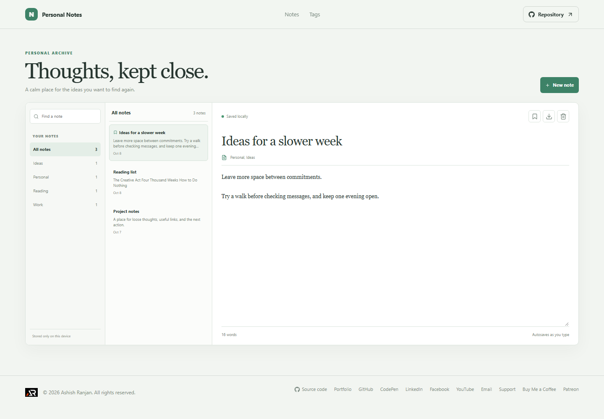

# Personal Notes Dashboard

Personal Notes Dashboard is a small local notebook for capturing ideas and finding them again by title, text, or tag.

## Interface

A tag rail and search field sit beside a note list and a focused editor. The editor includes pin, Markdown export, and delete actions.

## Features and use

Create a note, select it from the list, and edit its title, text, and comma-separated tags. Notes autosave as you type. Pin important notes to the top, filter by tag, search note contents, export the selected note as Markdown, or delete it after confirmation.

## Data and limits

Notes are stored in localStorage in the current browser profile. Markdown export saves a copy of the selected note. The notes are not encrypted, synced, or available in another browser automatically.

## Run locally

Use Node.js and npm, then run these commands from the project folder:

```sh
npm install
npm run dev
```

The app is built with React and Vite. Check the source and production build with:

```sh
npm run lint
npm run build
```

## Deployment

The public app is published with GitHub Pages at [https://a2rp.github.io/personal-notes-dashboard/](https://a2rp.github.io/personal-notes-dashboard/). To build and publish the current version, run:

```sh
npm run deploy
```

## Future improvements

Ideas that are not implemented yet:

- Markdown preview, folders, and encrypted cloud backup.

## Links

- Portfolio: [https://www.ashishranjan.net](https://www.ashishranjan.net)
- GitHub: [https://github.com/a2rp](https://github.com/a2rp)
- CodePen: [https://codepen.io/ash1198](https://codepen.io/ash1198)
- LinkedIn: [https://www.linkedin.com/in/aashishranjan](https://www.linkedin.com/in/aashishranjan)
- Facebook: [https://www.facebook.com/theash.ashish/](https://www.facebook.com/theash.ashish/)
- YouTube: [https://www.youtube.com/@ashishranjan-ashz?sub_confirmation=1](https://www.youtube.com/@ashishranjan-ashz?sub_confirmation=1)
- Email: [mailto:ash.ranjan09@gmail.com](mailto:ash.ranjan09@gmail.com)

## Support

- Support: [https://a2rp-donation-page.netlify.app/](https://a2rp-donation-page.netlify.app/)
- Buy Me a Coffee: [https://buymeacoffee.com/ashishranjan](https://buymeacoffee.com/ashishranjan)
- Patreon: [https://www.patreon.com/ashishranjan](https://www.patreon.com/ashishranjan)